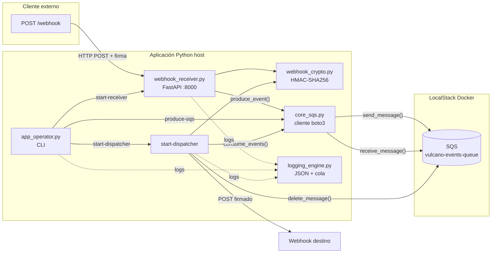
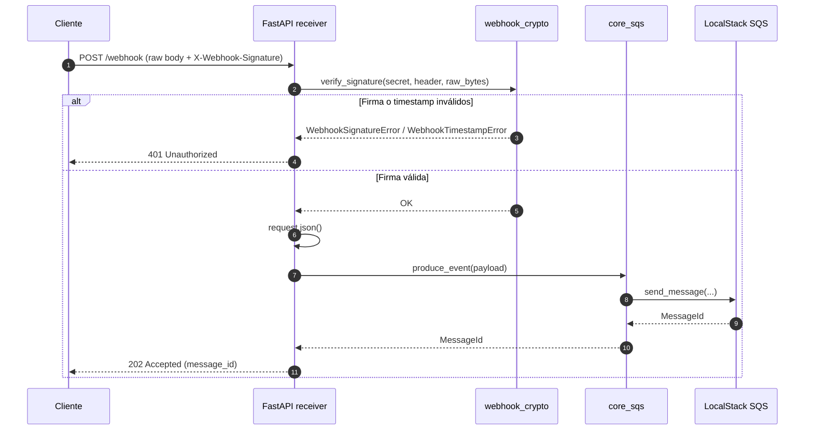
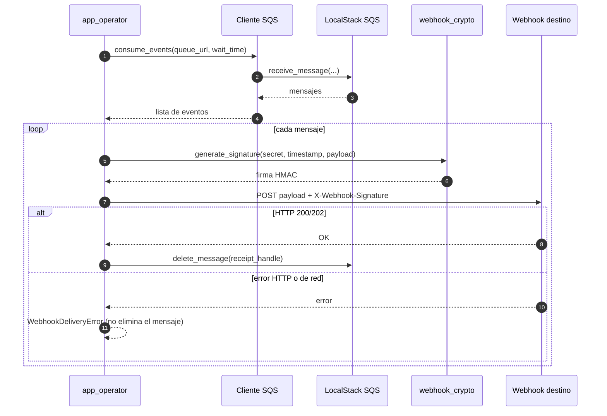
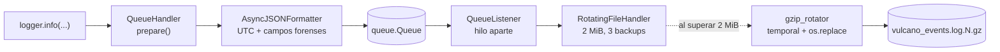

# Proyecto Vulcano Pay 🌋
Sistema de Procesamiento de Eventos, Webhooks HMAC y Observabilidad Asíncrona con Boto3 y LocalStack.

## Integrantes (Grupo: Los Chavos del 8)
- **Integrante 1**: Robustez de Entradas, Excepciones y Sanitización (`sanitizer.py`, `exceptions.py`)
- **Integrante 2**: Mensajería Asíncrona SQS con Boto3 y LocalStack (`core_sqs.py`)
- **Integrante 3**: Seguridad Criptográfica HMAC y Receptor Webhook (`webhook_crypto.py`, `webhook_receiver.py`)
- **Integrante 4**: Almacenamiento y Observabilidad JSON (`logging_engine.py`)
- **Integrante 5**: Coordinador de Integración y CLI (`app_operator.py`)
- **Integrante 6**: Simulación de Caos y Pruebas Forenses (`tests/`)

## Arquitectura y Flujos

### Vista general



### Recepción de un webhook



### Despacho de mensajes SQS



Si el envío falla, el mensaje no se elimina y SQS lo vuelve a hacer visible cuando vence el visibility timeout.

### Logging asíncrono



El formatter se ejecuta antes de encolar, en el hilo que produce el log. El `QueueListener` solo escribe en disco; `shutdown_vulcano_logging()` vacía la cola y cierra el archivo al finalizar.

## Requisitos Previos
- Python 3.11 o superior
- Docker
- Docker Compose (plugin `docker compose`)

## Instalación y Ejecución

### 1. Configurar las variables de entorno

Copiar el archivo de ejemplo:

```bash
cp .env.example .env
```

El archivo `.env` queda fuera de Git y contiene la configuración local. Docker Compose lo lee automáticamente. La aplicación Python no lo carga sola, por eso el paso 4 lo carga en la terminal.

### 2. Iniciar LocalStack

```bash
docker compose up -d
docker compose ps
```

Esperar a que el servicio figure como `healthy`. 

### 3. Crear el entorno virtual e instalar dependencias

En Linux o macOS:

```bash
python3 -m venv .venv
source .venv/bin/activate
```

En Windows PowerShell:

```powershell
python -m venv .venv
.venv\Scripts\Activate.ps1
```

Instalar las dependencias:

```bash
python -m pip install --upgrade pip
pip install -r requirements.txt
```

### 4. Cargar las variables en la terminal

En Linux o macOS, con el entorno virtual activado:

```bash
set -a
source .env
set +a
```

En Windows PowerShell se pueden definir manualmente:

```powershell
$env:AWS_ENDPOINT_URL = "http://localhost:4566"
$env:AWS_DEFAULT_REGION = "us-east-1"
$env:AWS_ACCESS_KEY_ID = "test"
$env:AWS_SECRET_ACCESS_KEY = "test"
```

### 5. Ejecutar la aplicación

Todos los comandos se ejecutan desde la raíz del proyecto, con el entorno virtual activado y las variables cargadas.

Iniciar el receptor de webhooks:

```bash
PYTHONPATH=src python -m app_operator start-receiver \
  --host 127.0.0.1 --port 8000
```

En otra terminal, publicar un evento en SQS:

```bash
PYTHONPATH=src python -m app_operator produce-sqs \
  --payload '{"event": "payment.completed", "amount": 150.0}'
```

Procesar un lote de mensajes y despacharlos al webhook:

```bash
PYTHONPATH=src python -m app_operator start-dispatcher \
  --queue vulcano-events-queue \
  --url http://localhost:8000/webhook
```

`start-dispatcher` procesa un lote y termina; se puede volver a ejecutar para procesar más mensajes.

### 6. Ejecutar las pruebas

Prueba del logging JSON, no requiere LocalStack:

```bash
PYTHONPATH=src pytest tests/test_forensic_log.py -v
```

Script de integración de SQS, requiere LocalStack encendido:

```bash
PYTHONPATH=src python tests/test_sqs_local.py
```

### 7. Apagar el entorno

```bash
deactivate
docker compose down
```

El compose no persiste los datos de LocalStack entre `down` y `up`. Si se vuelve a levantar el contenedor, hay que volver a crear la cola antes de ejecutar el proyecto.

## Video explicativo
[](https://youtu.be/epQwB_Zcu80).


